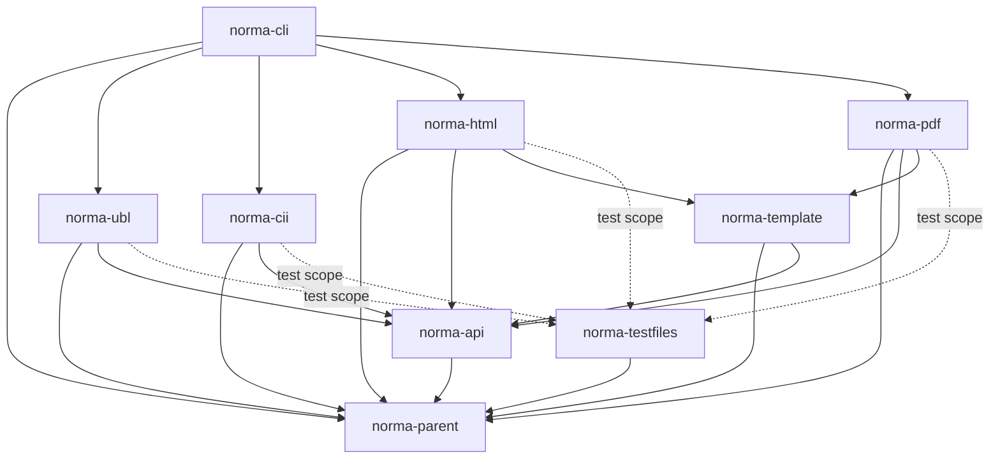

# Maven Module Structure

## Overview

`norma` is a multi-module Maven project. The root POM is a **BOM** (Bill of Materials) — it pins versions for `ph-commons`, `ph-ubl`, `ph-cii`, `ph-oton-html`, `ph-pdf-layout`, `picocli`, JUnit, etc. — and all submodules inherit from it.

Group ID: `com.helger.norma`. Initial version: `0.1.0-SNAPSHOT`.

## Module dependency diagram



Arrows mean "depends on" (solid = compile, dotted = test-scope). Notice that **no reader depends on a writer and vice versa** — they only share `norma-api`. This is what lets a caller pull only HTML rendering for UBL onto its classpath, leaving `ph-cii` and `ph-pdf-layout` out. Writers additionally depend on `norma-template`, which holds the JMustache + commonmark-java machinery and the default `.ntpl` resource — see [[Template Language]].

## Modules

### `norma-parent`

The root POM. Acts as the BOM for all dependency version management. Pins:

- `ph-commons` (via `ph-commons-parent-pom` import scope).
- `ph-ubl` (via `ph-ubl-parent-pom` import scope).
- `ph-cii` (via `ph-cii-parent-pom` import scope).
- `ph-oton-html` directly.
- `ph-pdf-layout` directly.
- `picocli`.
- JUnit 4 and AssertJ for tests.

No source code in this module. Modeled on `en16931-cii2ubl-parent-pom`.

### `norma-api`

The contract layer. Contains:

- **Intermediate model:** `NormaInvoice` and all `Norma*` child types (one per BG, plus reusable value objects). See [[Domain Model]].
- **SPIs:**
  - `IInvoiceReader<SRC>` — implemented by `norma-ubl` and `norma-cii`.
  - `IInvoiceWriter<O>` — implemented by `norma-html` and `norma-pdf`.
  - `INormaLabelResolver` — default implementation included; can be replaced.
  - `INormaTemplate` — implemented by `norma-template` (small marker interface so `AbstractRenderContext.setTemplate(...)` stays in `norma-api` without pulling JMustache or commonmark-java).
- **Render context:** `RenderContext`, `NormaFormatOptions`.
- **Formatting helpers:** `NormaFormat` (date/amount/percent/code-label formatting).
- **Resource bundles:** `norma-labels_en.properties`, `norma-labels_de.properties`, `norma-codelists_en.properties`, `norma-codelists_de.properties`. See [[Localization]].

**Dependencies:** `ph-commons` only. No JAXB, no PDF, no HTML libraries.

### `norma-ubl`

Reads UBL Invoice and CreditNote documents into a `NormaInvoice`. Supports **both** UBL versions that EN 16931 has a syntax binding for:

- **UBL 2.1** — EN 16931:2017 (current edition).
- **UBL 2.5** — EN 16931:2026 (upcoming edition).

No other UBL versions are in scope. Both bindings live in this single module because the reader logic and field-by-field mapping are nearly identical — see [[Source Readers]] for the rationale.

**Contains:**

- `UBLInvoiceReader implements IInvoiceReader<InputStream, NormaInvoice>` with `fromUBL21()`, `fromUBL25()`, and `autoDetect()` factory methods.
- Internal helpers for walking the UBL JAXB tree (shared between the two version bindings).

**Dependencies:** `norma-api`, `com.helger.ubl:ph-ubl21`, `com.helger.ubl:ph-ubl25`.

### `norma-cii`

Reads CII D16B `CrossIndustryInvoice` documents into a `NormaInvoice`.

**Contains:**

- `CIIInvoiceReader implements IInvoiceReader<InputStream>`.
- Internal helpers for walking the CII JAXB tree, code-list-driven dispatch.

**Dependencies:** `norma-api`, `com.helger.cii:ph-cii-d16b`.

### `norma-template`

Holds everything that turns a `.ntpl` source file plus a `NormaInvoice` into a renderable AST. See [[Template Language]] for the grammar.

**Contains:**

- `NormaTemplate implements INormaTemplate` with factory methods `fromClasspath(String)`, `fromString(String)`, `fromFile(Path)`.
- The JMustache wiring: a `Mustache.CustomContext` that resolves BT/BG paths and format modifiers against a `NormaInvoice`, plus the `{{label:...}}` adapter that routes through `INormaLabelResolver`.
- The commonmark-java configuration: `Parser` with `TablesExtension` and `StrikethroughExtension` enabled, plus a tiny post-pass that lifts `{{class:...}}` block attributes and `{{pagebreak}}` markers out of the parsed AST into sidecar maps.
- The default template `default.ntpl` (language-independent — all literal strings route through `{{label:...}}` resource bundles in `norma-api`).
- `NormaTemplateAST` — the value type the two emitter modules consume.

**Dependencies:** `norma-api`, `com.samskivert:jmustache`, `org.commonmark:commonmark`, `org.commonmark:commonmark-ext-gfm-tables`, `org.commonmark:commonmark-ext-gfm-strikethrough`. No HTML or PDF libraries — those live in the emitter modules.

**Why a separate module:** code organization and reuse — the parser, the Mustache-to-`NormaInvoice` adapter, and the default `.ntpl` are shared by both writers, so they belong in one place. It also draws a clean line between the template engine and the model: `norma-template` depends on `norma-api` but the reverse is not true, so the model stays free of JMustache/commonmark-java types. A consumer who only reads invoices (`norma-api` + `norma-ubl` or `norma-cii`) does not pick up the template-engine jars at all; a consumer who writes invoices via `norma-html` or `norma-pdf` does pick them up transitively (~225 KB total), even if they never call `setTemplate(...)`.

### `norma-html`

Renders a `NormaInvoice` to HTML5.

**Contains:**

- `HTMLInvoiceWriter implements IInvoiceWriter<String>` (with overloads that return `HCHtml` or stream to an `OutputStream`).
- Section renderer classes (`HeaderSectionRenderer`, `PartiesSectionRenderer`, `LinesSectionRenderer`, ...) used when no template is set on the context.
- `HTMLTemplateEmitter` — a commonmark-java `AbstractVisitor` subclass that walks a `NormaTemplateAST` and produces an `HCNode` tree. Used when `RenderContext.getTemplate() != null`.
- A default CSS stylesheet, loaded from a classpath resource.

**Dependencies:** `norma-api`, `norma-template`, `com.helger.photon:ph-oton-html`.

### `norma-pdf`

Renders a `NormaInvoice` to PDF.

**Contains:**

- `PDFInvoiceWriter implements IInvoiceWriter<Void>` (writes to a supplied `OutputStream` or `File`).
- Section renderer classes mirroring `norma-html`'s layout, used when no template is set on the context.
- `PDFTemplateEmitter` — a commonmark-java `AbstractVisitor` subclass that walks a `NormaTemplateAST` and produces `PLPageSet` content; paragraphs feed their inline content through `ph-pdf-layout`'s CommonMark-compatible inline parser.
- Default `FontSpec` set (Helvetica regular + bold).

**Dependencies:** `norma-api`, `norma-template`, `com.helger:ph-pdf-layout`.

### `norma-cli`

A command-line wrapper. Picocli-based, shaded into a fat JAR for `java -jar` use.

**Synopsis (proposed):**

```
norma render --in invoice.xml --out invoice.html --format html --lang de
norma render --in invoice.xml --out invoice.pdf  --format pdf  --lang en
norma render --in invoice.xml                    --format html  # to stdout
```

Auto-detects source syntax (UBL vs CII) from the root element.

**Dependencies:** `norma-ubl`, `norma-cii`, `norma-html`, `norma-pdf`, `picocli`. Produces `norma-cli/target/norma-cli-full.jar` via the Maven shade plugin, matching the layout of `en16931-cii2ubl-cli`.

### `norma-testfiles`

A shared corpus of example invoices used by every reader and writer test. Modeled directly on `ph-cii-testfiles` from `../ph-cii/ph-cii-testfiles/` — packaging is plain `jar` (not `test-jar`), so consumers depend on it with `<scope>test</scope>`. The files are real EN 16931-conformant instances, hand-curated as "good cases" for regression testing.

**Folder layout** under `src/main/resources/external/en16931/`:

```
norma-testfiles/src/main/resources/external/en16931/
├── 2017/                            # EN 16931:2017 (current edition)
│   ├── ubl/
│   │   ├── invoice/                 # *.xml — UBL 2.1 Invoice
│   │   └── creditnote/              # *.xml — UBL 2.1 CreditNote
│   └── cii/                         # *.xml — CII D16B CrossIndustryInvoice
├── 2026/                            # EN 16931:2026 (upcoming edition)
│   ├── ubl/
│   │   ├── invoice/                 # *.xml — UBL 2.5 Invoice
│   │   └── creditnote/              # *.xml — UBL 2.5 CreditNote
│   └── cii/                         # *.xml — TBD syntax revision once published
```

**Java side:** a small `MockNormaTestFiles` class in `com.helger.norma.testfiles` exposes typed lookups (`getUBL21InvoiceFiles()`, `getCIID16BFiles()`, etc.) returning `ICommonsList<IReadableResource>`. Test classes iterate those lists rather than walking the filesystem directly.

**Dependencies:** `ph-commons` only — this module deliberately has no dependency on `norma-api`, so it can be consumed even by experiments outside this project.

**Why a separate module:** keeping test data out of `norma-ubl` / `norma-cii` test resources avoids duplicating the corpus across modules, keeps reader-test artifacts tiny, and gives the corpus its own version life so adding files doesn't churn the reader Jar.

## Why this split

| Decision | Rationale |
|----------|-----------|
| `api` separate from readers/writers | A consumer that only writes HTML for UBL pulls `norma-api` + `norma-ubl` + `norma-html` (≈ ph-commons + ph-ubl21 + ph-oton-html), not the world. |
| Readers split per syntax (not per version) | `norma-ubl` handles UBL 2.1 (EN 16931:2017) and UBL 2.5 (EN 16931:2026) together — those are the only two UBL versions EN 16931 has a binding for, and their reader logic is shared. CII binding lives in its own module. |
| Writers split per format | Adding a text/plain or DOCX writer is one module with no cross-cutting changes. |
| `norma-template` separate from `norma-api` | JMustache and commonmark-java are pulled onto the classpath only for consumers who actually use templates. Marker `INormaTemplate` interface stays in `norma-api` so `setTemplate(...)` is typed everywhere without dragging the parsers in. |
| CLI in its own module | The fat JAR is awkward and shouldn't be on consumers' classpaths. Same shape as `en16931-cii2ubl-cli`. |

## Build commands

```bash
mvn clean compile                # Compile all modules
mvn clean test                   # Run all tests
mvn clean package                # Build all JARs + the CLI fat JAR
mvn test -pl norma-ubl           # Run only the UBL reader tests
mvn test -pl norma-pdf -Dtest=PDFInvoiceWriterTest#testHelloWorld
```

Requires Java 17+ (matches `en16931-cii2ubl`).
